<p align="center">
  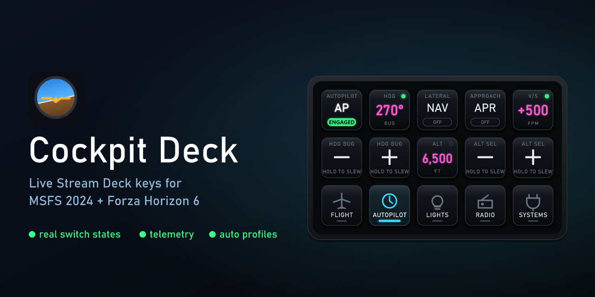
</p>

<h1 align="center">Cockpit Deck</h1>

<p align="center">
  A Stream Deck plugin that turns a 15-key Stream Deck into a <b>live cockpit panel</b> for
  <b>Microsoft Flight Simulator 2024</b> and a <b>telemetry dashboard</b> for <b>Forza Horizon 6</b>.<br>
  Every key shows the game's real state: gear lights, autopilot modes, radio frequencies, revs, tyre temperatures.
</p>

<p align="center">
  
  
  
  
  
</p>

---

## Contents

- [Why this exists](#why-this-exists)
- [Features](#features)
- [Microsoft Flight Simulator 2024](#microsoft-flight-simulator-2024)
  - [Flight](#flight-page) · [Autopilot](#autopilot-page) · [Lights](#lights-page) · [Radio](#radio-page) · [Systems](#systems-page)
- [Forza Horizon 6](#forza-horizon-6)
- [What the colours mean](#what-the-colours-mean)
- [Install](#install)
- [Automatic profile switching](#automatic-profile-switching)
- [Settings file](#settings-file)
- [How it works](#how-it-works)
- [Project layout](#project-layout)
- [Building and testing](#building-and-testing)
- [Troubleshooting](#troubleshooting)
- [Testing status and known limits](#testing-status-and-known-limits)
- [Version history](#version-history)
- [Credits](#credits)
- [License](#license)

---

## Why this exists

Most Stream Deck game profiles are a grid of hotkeys with static icons. A key labelled *GEAR* fires the gear
keybind, but it can't tell you whether the gear is up, down or still moving, and it breaks the moment you
rebind a key.

Cockpit Deck works differently:

| | Typical hotkey profile | Cockpit Deck |
|---|---|---|
| Shows real state (gear, lights, AP modes) | ✗ static icon | ✓ read live from the sim |
| Depends on your keybinds (MSFS) | ✓ breaks if you rebind | ✗ talks to the sim directly via SimConnect |
| Shows numbers (IAS, ALT, heading bug, frequencies) | ✗ | ✓ updated up to 15× a second |
| Knows when the sim isn't running | ✗ | ✓ keys go dim, tab shows **NO SIM** |
| Switches profile when the game starts | Manual setup per profile | ✓ built in, and switches back on exit |
| Icons | Fixed bitmaps | Drawn on the fly at 144×144 (crisp on MK.2) |

## Features

- **5 MSFS pages, 50 live keys:** Flight, Autopilot, Lights, Radio and Systems, switched with tabs on the bottom row.
- **Real annunciators:** switches light up only when the sim says they're on, not when you pressed them.
- **Three-light landing gear:** green = down and locked, red = in transit, dark = up. Fixed-gear aircraft are labelled.
- **Hold-to-slew:** hold a ± key and the heading bug, altitude or frequency keeps moving (400 ms delay, then every 110 ms).
- **Forza telemetry dash:** speed, gear, rev bar with shift light, boost, race position, lap times, tyre temps, power, top speed.
- **Automatic profiles:** starting `FlightSimulator2024.exe` or `forzahorizon6.exe` puts the deck on the matching profile, and closing the game puts it back.
- **Fails visibly:** pressing a sim key with no sim connected shows Stream Deck's ⚠ alert. Missing data shows dashes, never stale numbers.
- **Light on resources:** a key is redrawn only when its picture actually changes, and each frame is about 1 ms to render.

---

## Microsoft Flight Simulator 2024

The bottom row holds five **tabs** on every page. The active tab is lit cyan. When MSFS isn't running,
it shows **NO SIM** in amber and every value key shows dashes.

All keys talk to the sim through **SimConnect**: presses fire standard sim events and states are read from
SimVars. No keyboard bindings are involved, so it doesn't matter how you've set up your controls.

### Flight page

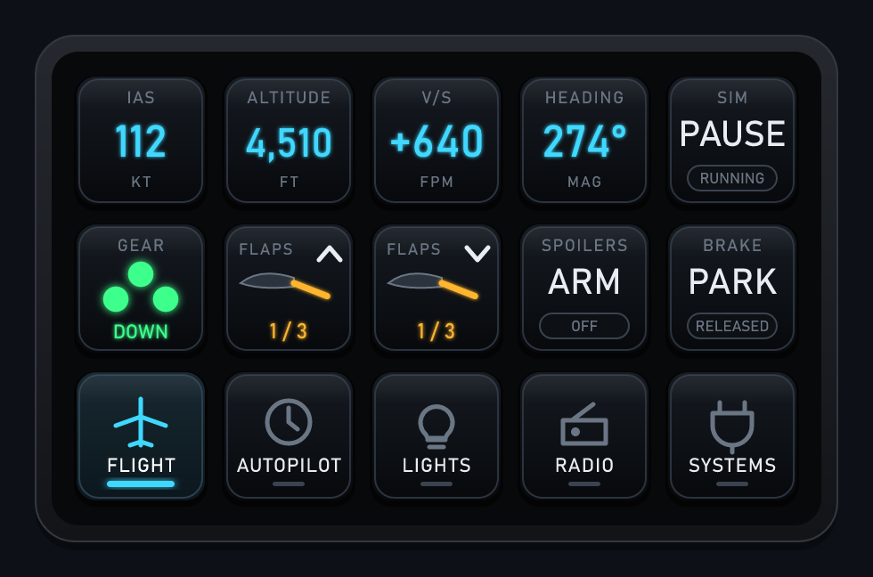

| Key | Shows | Press does | Sim data used |
|---|---|---|---|
| **IAS** | Indicated airspeed, knots | — | `AIRSPEED INDICATED` |
| **ALTITUDE** | Indicated altitude, nearest 10 ft | — | `INDICATED ALTITUDE` |
| **V/S** | Vertical speed with sign, nearest 10 fpm | — | `VERTICAL SPEED` |
| **HEADING** | Magnetic heading, 001–360° | — | `PLANE HEADING DEGREES MAGNETIC` |
| **PAUSE** | RUNNING / PAUSED | Toggle pause | `PAUSE_TOGGLE`, sim `Pause` event |
| **GEAR** | 3 lights + DOWN / UP / TRANSIT | Gear up/down | `GEAR_TOGGLE`, `GEAR HANDLE POSITION`, `GEAR CENTER/LEFT/RIGHT POSITION`, `IS GEAR RETRACTABLE` |
| **FLAPS ▲** | Flap position graphic + `n / total` | One notch up | `FLAPS_DECR`, `FLAPS HANDLE INDEX`, `FLAPS NUM HANDLE POSITIONS` |
| **FLAPS ▼** | Same as above | One notch down | `FLAPS_INCR` |
| **SPOILERS ARM** | ARMED / OFF | Arm/disarm | `SPOILERS_ARM_TOGGLE`, `SPOILERS ARMED` |
| **BRAKE PARK** | SET (red) / RELEASED | Toggle parking brake | `PARKING_BRAKES`, `BRAKE PARKING POSITION` |

On approach, with the gear moving, flaps at 2 of 3 and spoilers armed:

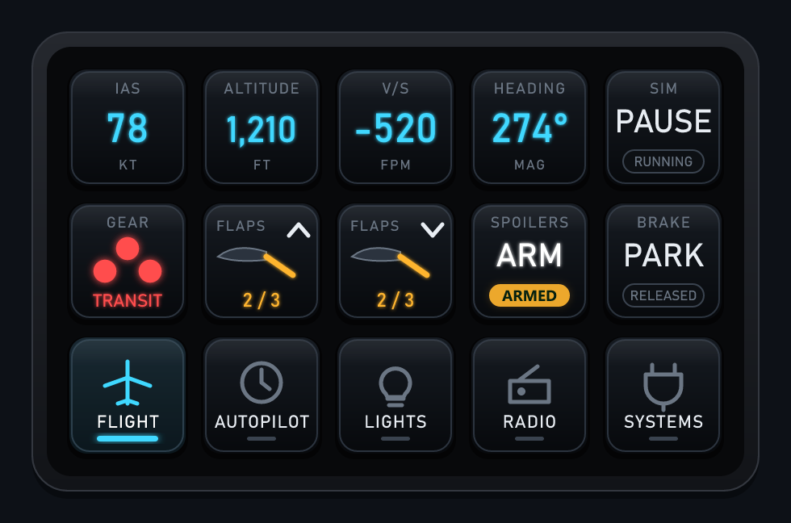

### Autopilot page

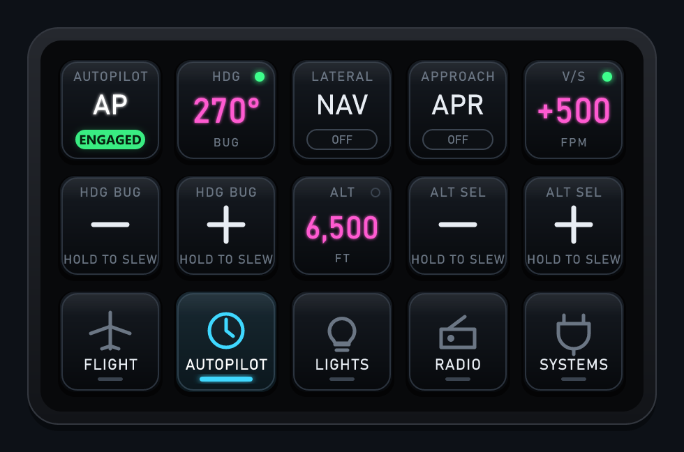

| Key | Shows | Press does | Sim data used |
|---|---|---|---|
| **AP** | ENGAGED / OFF | Autopilot master | `AP_MASTER`, `AUTOPILOT MASTER` |
| **HDG** | Heading bug (magenta). Green dot = HDG mode active | Heading mode on/off | `AP_PANEL_HEADING_HOLD`, `AUTOPILOT HEADING LOCK DIR`, `AUTOPILOT HEADING LOCK` |
| **NAV** | ON / OFF | NAV mode | `AP_NAV1_HOLD`, `AUTOPILOT NAV1 LOCK` |
| **APR** | ON / OFF | Approach mode | `AP_APR_HOLD`, `AUTOPILOT APPROACH HOLD` |
| **V/S** | Target vertical speed. Green dot = V/S mode active | V/S mode on/off | `AP_PANEL_VS_HOLD`, `AUTOPILOT VERTICAL HOLD VAR`, `AUTOPILOT VERTICAL HOLD` |
| **HDG BUG −** / **+** | — | Move heading bug (hold to slew) | `HEADING_BUG_DEC` / `HEADING_BUG_INC` |
| **ALT** | Selected altitude. Green dot = ALT hold active | Altitude hold on/off | `AP_PANEL_ALTITUDE_HOLD`, `AUTOPILOT ALTITUDE LOCK VAR`, `AUTOPILOT ALTITUDE LOCK` |
| **ALT SEL −** / **+** | — | Change selected altitude (hold to slew) | `AP_ALT_VAR_DEC` / `AP_ALT_VAR_INC` |

### Lights page

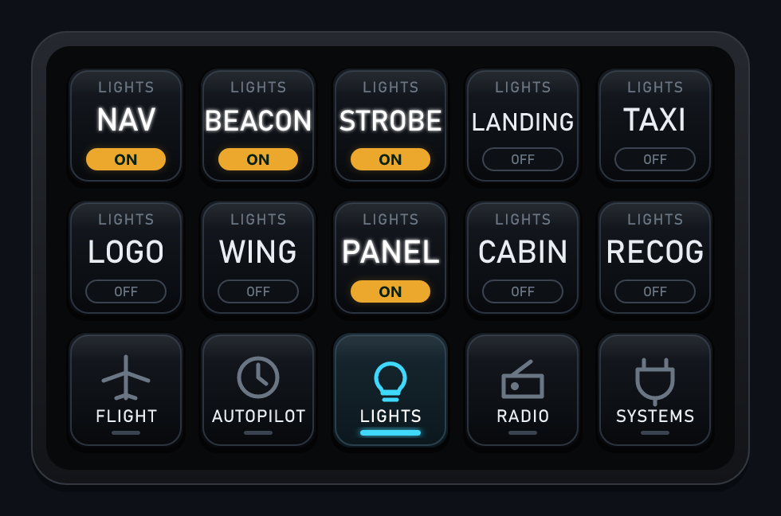

Ten light switches, each lit amber when the light is actually on:

| Key | Press does | State from |
|---|---|---|
| NAV | `TOGGLE_NAV_LIGHTS` | `LIGHT NAV` |
| BEACON | `TOGGLE_BEACON_LIGHTS` | `LIGHT BEACON` |
| STROBE | `STROBES_TOGGLE` | `LIGHT STROBE` |
| LANDING | `LANDING_LIGHTS_TOGGLE` | `LIGHT LANDING` |
| TAXI | `TOGGLE_TAXI_LIGHTS` | `LIGHT TAXI` |
| LOGO | `TOGGLE_LOGO_LIGHTS` | `LIGHT LOGO` |
| WING | `TOGGLE_WING_LIGHTS` | `LIGHT WING` |
| PANEL | `PANEL_LIGHTS_TOGGLE` | `LIGHT PANEL` |
| CABIN | `TOGGLE_CABIN_LIGHTS` | `LIGHT CABIN` |
| RECOG | `TOGGLE_RECOGNITION_LIGHTS` | `LIGHT RECOGNITION` |

### Radio page

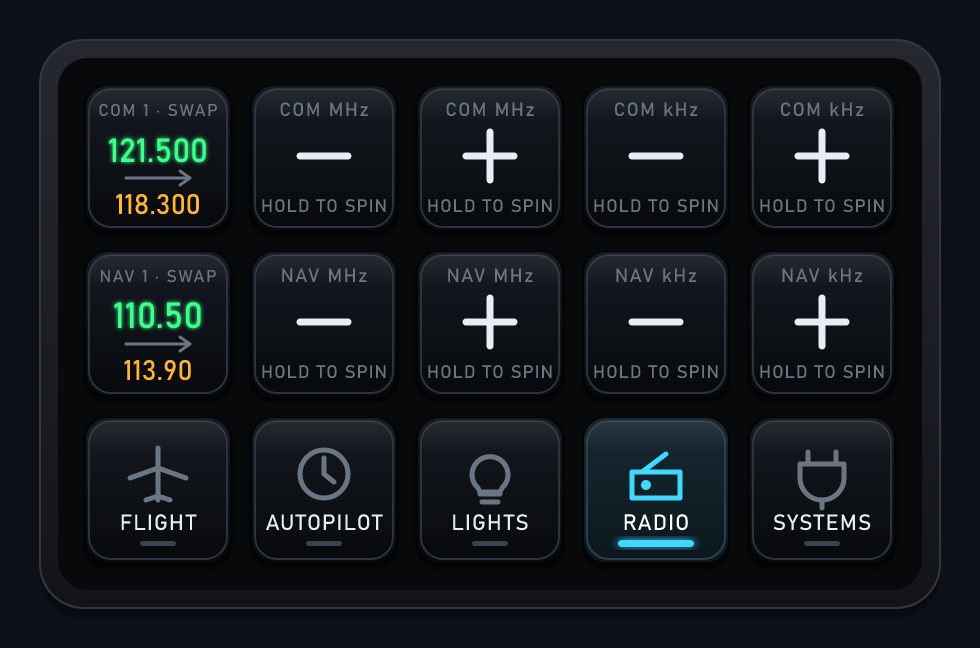

The left key shows the **active** frequency in green and the **standby** in amber. Tap it to swap them.
The four keys beside it tune the standby frequency, and holding them spins the knob.

| Key | Press does | Sim data used |
|---|---|---|
| **COM 1 · SWAP** | Swap active/standby | `COM_STBY_RADIO_SWAP`, `COM ACTIVE FREQUENCY:1`, `COM STANDBY FREQUENCY:1` |
| COM MHz − / + | Whole MHz | `COM_RADIO_WHOLE_DEC` / `COM_RADIO_WHOLE_INC` |
| COM kHz − / + | Fraction | `COM_RADIO_FRACT_DEC` / `COM_RADIO_FRACT_INC` |
| **NAV 1 · SWAP** | Swap active/standby | `NAV1_RADIO_SWAP`, `NAV ACTIVE FREQUENCY:1`, `NAV STANDBY FREQUENCY:1` |
| NAV MHz − / + | Whole MHz | `NAV1_RADIO_WHOLE_DEC` / `NAV1_RADIO_WHOLE_INC` |
| NAV kHz − / + | Fraction | `NAV1_RADIO_FRACT_DEC` / `NAV1_RADIO_FRACT_INC` |

### Systems page

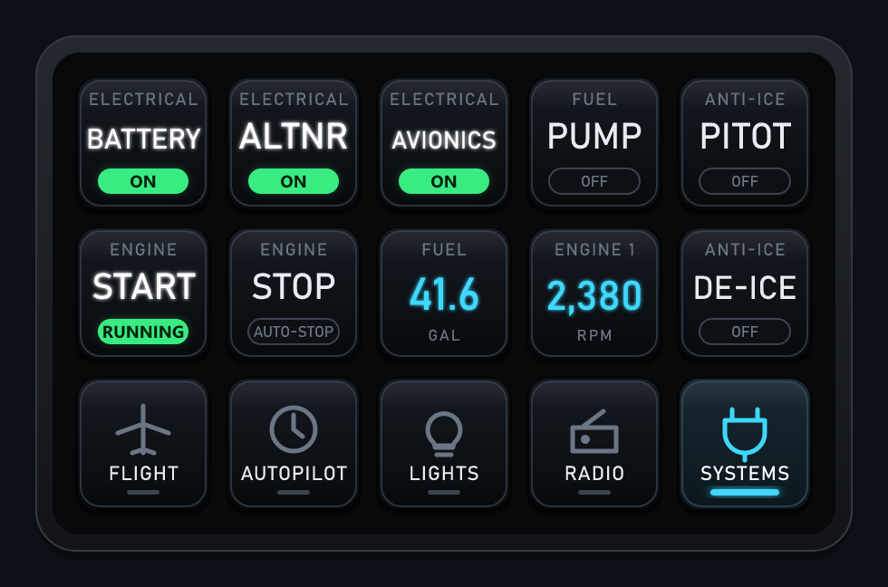

| Key | Shows | Press does | Sim data used |
|---|---|---|---|
| BATTERY | ON / OFF | Master battery | `TOGGLE_MASTER_BATTERY`, `ELECTRICAL MASTER BATTERY` |
| ALTNR | ON / OFF | Alternator | `TOGGLE_MASTER_ALTERNATOR`, `GENERAL ENG MASTER ALTERNATOR:1` |
| AVIONICS | ON / OFF | Avionics master | `TOGGLE_AVIONICS_MASTER`, `AVIONICS MASTER SWITCH` |
| FUEL PUMP | ON / OFF | Electric fuel pump 1 | `TOGGLE_ELECT_FUEL_PUMP1`, `GENERAL ENG FUEL PUMP SWITCH:1` |
| PITOT | ON / OFF | Pitot heat | `PITOT_HEAT_TOGGLE`, `PITOT HEAT` |
| ENGINE START | RUNNING when engine 1 is burning fuel | Auto-start (same as Ctrl+E) | `ENGINE_AUTO_START`, `ENG COMBUSTION:1` |
| ENGINE STOP | — | Auto-shutdown | `ENGINE_AUTO_SHUTDOWN` |
| FUEL | Total fuel, gallons | — | `FUEL TOTAL QUANTITY` |
| ENGINE 1 | RPM, nearest 10 | — | `GENERAL ENG RPM:1` |
| DE-ICE | ON / OFF | Structural de-ice | `TOGGLE_STRUCTURAL_DEICE`, `STRUCTURAL DEICE SWITCH` |

### When the sim isn't running

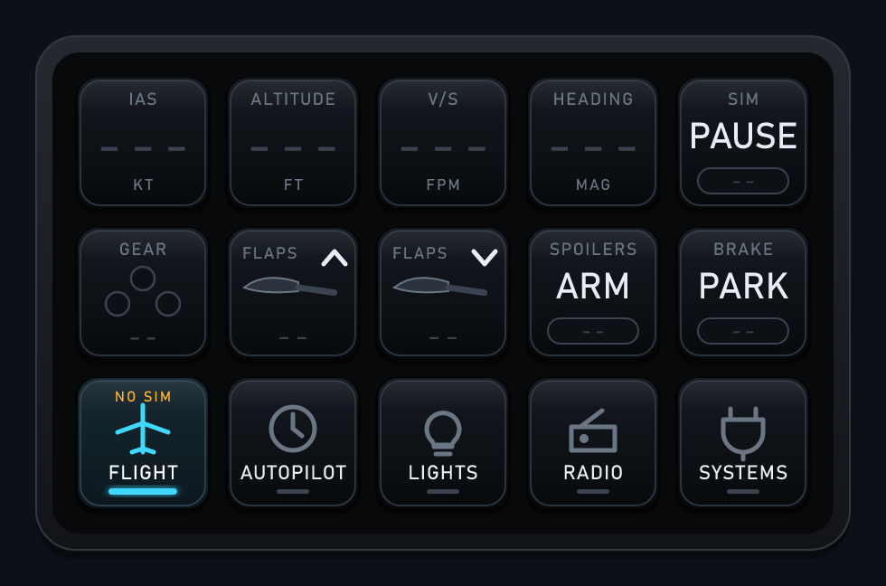

Every value is replaced by dashes and the active tab says **NO SIM**. The plugin retries the connection
every 5 seconds, so you can start the plugin and the sim in any order.

---

## Forza Horizon 6

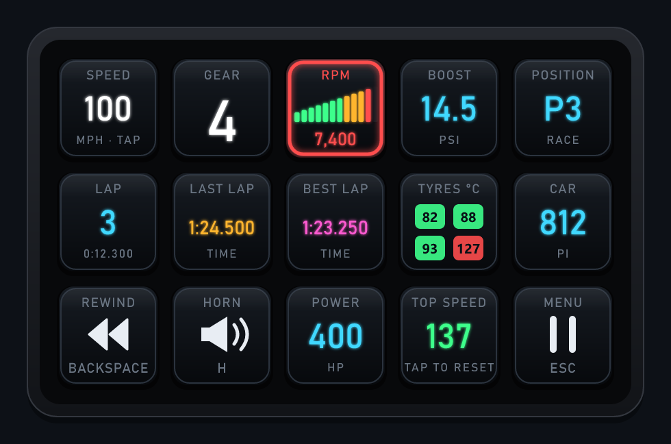

Forza can stream live telemetry over your local network ("Data Out"). Cockpit Deck listens for it and turns it into a dash.

| Key | Shows | Press does |
|---|---|---|
| **SPEED** | Current speed | Toggle **MPH ↔ KM/H** (remembered) |
| **GEAR** | Current gear. **R** in red for reverse | — |
| **RPM** | 12-segment rev bar (green / amber / red). At 92% of the redline the key gets a red **shift light** border | — |
| **BOOST** | Turbo/supercharger boost, psi | — |
| **POSITION** | Race position (P3) or FREE ROAM | — |
| **LAP** | Lap number and current lap time (races only) | — |
| **LAST LAP** / **BEST LAP** | m:ss.fff | — |
| **TYRES °C** | All four tyres, colour-coded: blue < 60, green < 95, amber < 115, red above | — |
| **CAR** | Performance Index (PI) | — |
| **REWIND** | — | Sends **Backspace** (Forza's default rewind key) |
| **HORN** | — | Sends **H** (default horn key) |
| **POWER** | Current engine power, hp | — |
| **TOP SPEED** | Highest speed this session | Reset |
| **MENU** | — | Sends **Esc** |

The three game keys show which key they send, and you can change them in the [settings file](#settings-file).
Keys are sent as hardware scan codes, which games read like a real keyboard.

### Turning on Forza's telemetry

1. In Forza Horizon 6 open **Settings → HUD and Gameplay**.
2. Set **Data Out** to **On**.
3. Set **Data Out IP Address** to `127.0.0.1` and **Data Out IP Port** to `5300`.
4. Drive. The dash comes alive within a second.

Until data arrives, the dash looks like this:

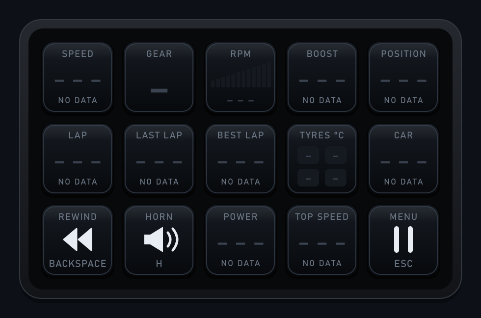

> **Still showing NO DATA?** Xbox-app games sometimes can't send to `127.0.0.1`. Put your PC's own network
> address in Forza instead (find it with `ipconfig`, e.g. `192.168.1.20`). Cockpit Deck listens on all of your
> PC's addresses, so no other change is needed. If Windows asks about the firewall, allow **Private networks** only.

---

## What the colours mean

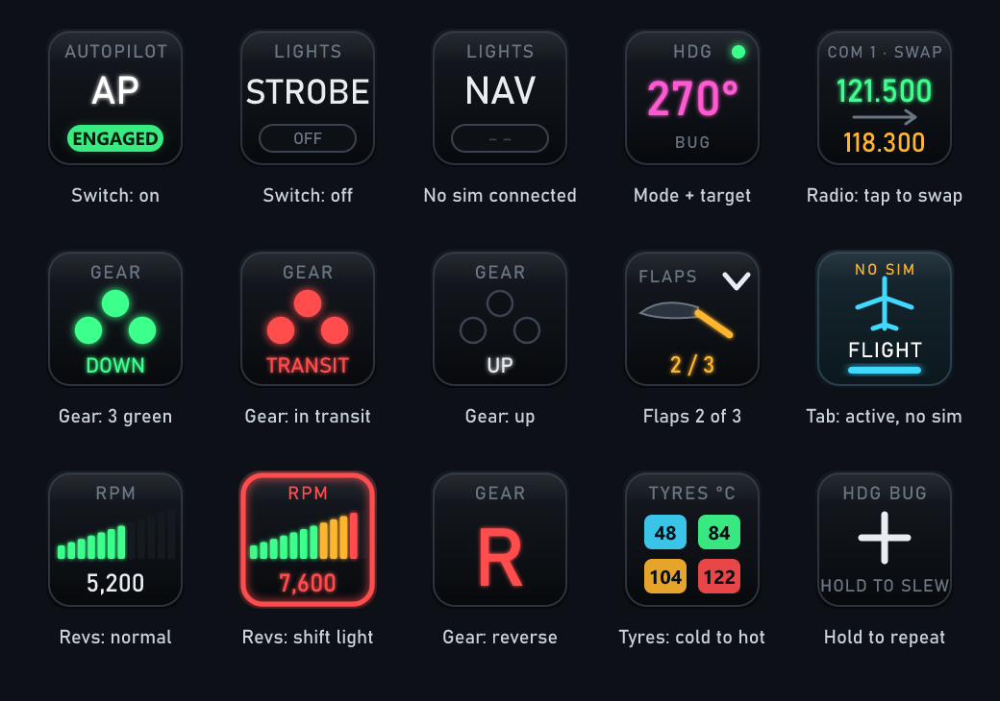

| Colour | Meaning |
|---|---|
| 🟢 **Green** | On, engaged, gear down and locked, active radio frequency |
| 🟠 **Amber** | Lights on, armed, flaps extended, standby frequency, caution |
| 🔴 **Red** | Gear in transit, parking brake set, shift now, reverse, hot tyres |
| 🔵 **Cyan** | Live readouts and the selected tab |
| 🟣 **Magenta** | Autopilot targets (heading bug, selected V/S and altitude), like a real flight director |
| ⚫ **Dim + dashes** | No data: the game isn't running or isn't sending |

---

## Install

### Option A: the ready-made package

1. Download `com.local.cockpitdeck.streamDeckPlugin` from the [latest release](../../releases/latest).
2. Double-click it. Stream Deck asks to install the plugin, so click **Install**.
3. Stream Deck adds two profiles for your 15-key deck: **CockpitDeck-MSFS2024** and **CockpitDeck-Forza**.

Updating works the same way: double-click a newer package and confirm.

### Option B: build it yourself

See [Building and testing](#building-and-testing).

### Requirements

- Windows 10 or 11 (x64)
- Stream Deck software **6.5 or newer** (developed and tested on 7.6)
- A **15-key** Stream Deck (MK.2 / original). The profiles are laid out 5 × 3.
- MSFS 2024 and/or Forza Horizon 6 (Microsoft Store / Xbox app versions were used during development)

---

## Automatic profile switching

The plugin checks running programs every 3 seconds:

| Program starts | Deck switches to |
|---|---|
| `FlightSimulator2024.exe` | **CockpitDeck-MSFS2024** |
| `forzahorizon6.exe` | **CockpitDeck-Forza** |

When the game closes, the deck goes back to the profile you were using before. It only switches back if
Cockpit Deck switched it in the first place, so a profile you picked yourself is never changed.

To turn this off, set `"autoSwitch": false` in the [settings file](#settings-file). You can always pick
the profiles by hand from Stream Deck's profile menu.

---

## Settings file

`%APPDATA%\CockpitDeck\config.json` is created on first run. Changes are picked up within 2 seconds, with no restart needed.

```json
{
  "autoSwitch": true,
  "forza": {
    "port": 5300,
    "listen": "0.0.0.0",
    "units": "mph",
    "keys": {
      "rewind": "BACKSPACE",
      "horn": "H",
      "pause": "ESC"
    }
  }
}
```

| Setting | What it does |
|---|---|
| `autoSwitch` | `true` switches profiles when a game starts or stops. |
| `forza.port` | UDP port to listen on. Must match **Data Out IP Port** in Forza. |
| `forza.listen` | `0.0.0.0` = all of your PC's addresses (recommended). `127.0.0.1` = this PC only. |
| `forza.units` | `mph` or `kmh`. The SPEED key toggles this too. |
| `forza.keys.*` | Key sent by REWIND, HORN and MENU. Use `+` for combinations, e.g. `"Ctrl+Shift+H"`. |

**Key names you can use:** `A`–`Z`, `0`–`9`, `F1`–`F12`, `ESC`, `TAB`, `ENTER`, `SPACE`, `BACKSPACE`,
`SHIFT`/`LSHIFT`/`RSHIFT`, `CTRL`/`LCTRL`/`RCTRL`, `ALT`/`LALT`/`RALT`, `UP`/`DOWN`/`LEFT`/`RIGHT`,
`HOME`, `END`, `PAGEUP`, `PAGEDOWN`, `INSERT`, `DELETE`, `CAPSLOCK`, `MINUS`, `EQUALS`, `LBRACKET`,
`RBRACKET`, `SEMICOLON`, `APOSTROPHE`, `GRAVE`, `BACKSLASH`, `COMMA`, `PERIOD`, `SLASH`,
`NUM0`–`NUM9`, `NUMPLUS`, `NUMMINUS`, `NUMSTAR`, `NUMSLASH`, `NUMPERIOD`, `NUMENTER`.
An unknown name shows the ⚠ alert on the key and is written to the log.

---

## How it works

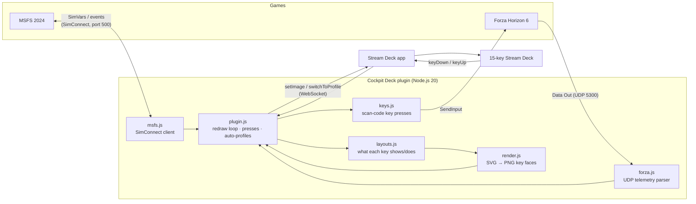

**Under the hood:**

- **One action, position-aware.** The plugin has a single action, *Cockpit key*. Each key works out what to
  show from where it sits on the deck (row × 5 + column) and which game it's set to. The bundled profiles
  just fill all 15 positions, and the pages are handled inside the plugin, so switching tabs is instant.
- **SimConnect without the SDK.** [`node-simconnect`](https://github.com/EvenAR/node-simconnect) speaks the
  SimConnect protocol directly. Each SimVar gets its own data request, so a variable an aircraft doesn't
  have can't throw the others out of line. Updates are only sent when a value changes. The connection is
  found through the registry, with the static local port from MSFS 2024's `SimConnect.xml` (500) as a fallback.
- **Forza packets.** Forza's "dash" format is parsed by size: 324-byte Horizon packets (dash data at byte
  244), with Motorsport's 311/331-byte layouts also understood. Packets that fail sanity checks are dropped,
  so a garbled packet never reaches the keys. If data stops for 1.5 s, the dash shows **NO DATA**.
- **Key faces.** Every face is an SVG drawn by `render.js` and turned into a 144×144 PNG with
  [`resvg`](https://github.com/yisibl/resvg-js) using Windows' Bahnschrift font. It's done in the plugin
  because Stream Deck's own SVG support can't draw glows. Rendered images are cached, redraws are capped at
  about 15 fps, and an image is only sent to the deck when it differs from the last one.
- **Key presses.** [`koffi`](https://github.com/Koromix/koffi) calls Windows' `SendInput` with hardware scan
  codes and holds each key for 60 ms, which DirectX and GDK games pick up reliably.

---

## Project layout

```
Stream Deck Things/
├── README.md
├── CHANGELOG.md
├── docs/images/                         # pictures in this README (generated)
└── cockpitdeck/
    ├── com.local.cockpitdeck.sdPlugin/  # the plugin itself
    │   ├── manifest.json                # plugin + profile declarations
    │   ├── pi.html                      # key settings panel (choose game)
    │   ├── package.json                 # dependencies
    │   ├── bin/
    │   │   ├── plugin.js                # Stream Deck connection, redraw loop, presses, auto-profiles
    │   │   ├── layouts.js               # every page and key: what it shows and what it does
    │   │   ├── render.js                # key-face drawing (SVG → PNG)
    │   │   ├── msfs.js                  # SimConnect client
    │   │   ├── forza.js                 # Forza Data Out listener + parser
    │   │   └── keys.js                  # scan-code key presses
    │   ├── imgs/                        # plugin / action icons (generated)
    │   └── *.streamDeckProfile          # bundled profiles (generated)
    └── tools/
        ├── build.ps1                    # icons + profiles + package → dist/
        ├── build.js                     # draws icons, writes profile layouts
        ├── test.js                      # 26 automated checks
        ├── fixtures.js                  # sample flight + race data for tests and pictures
        ├── preview.js                   # renders a 5×3 page to one PNG
        └── screenshots.js               # regenerates docs/images
```

---

## Building and testing

You need **Node.js 20+** and **PowerShell** on Windows.

```powershell
cd cockpitdeck\com.local.cockpitdeck.sdPlugin
npm ci                                   # install the libraries
```

**Run the tests:**

```powershell
node ..\tools\test.js "$env:TEMP\cockpitdeck-test" (Get-Command node).Source
```

The 26 checks cover:

| Area | What's checked |
|---|---|
| Forza parser | Byte offsets for all three packet sizes, speed/power/tyre conversions, reverse & neutral, junk packets rejected |
| Profiles | The names used for auto-switching exist in `manifest.json` and as profile files |
| Rendering | All 5 MSFS pages (live and no-sim) and the Forza dash (live and no-data) draw without errors |
| End-to-end | Starts the real plugin against a fake Stream Deck and checks registration, all 15 keys drawn as PNG, tab presses changing pages, ⚠ alert with no sim, Forza packets updating the dash, no crash |

The end-to-end test uses its own data folder and port (5399), so it never touches an installed copy.

**Build the installable package:**

```powershell
cd cockpitdeck
.\tools\build.ps1                        # → dist\com.local.cockpitdeck.streamDeckPlugin
```

To install over an existing copy, raise `Version` in `manifest.json` first. Stream Deck skips a package
whose version is already installed.

**Regenerate the README pictures:**

```powershell
node cockpitdeck\tools\screenshots.js
```

**Debug build:** put an empty file named `debug.flag` next to `manifest.json` before building. That build
saves every key image it sends to `%APPDATA%\CockpitDeck\debug\` and opens a local-only diagnostics
endpoint on `127.0.0.1:28650`. Remove the file again for normal use.

---

## Troubleshooting

| Problem | Fix |
|---|---|
| MSFS keys stay on **NO SIM** | Make sure you're in a flight or the main menu, not the loading screen. The plugin retries every 5 s. Check `%APPDATA%\CockpitDeck\plugin.log` for `msfs connected`. |
| A switch key does nothing in one aircraft | Some study-level add-ons (PMDG, Fenix, etc.) use their own systems and ignore standard sim events. Default and most third-party aircraft respond. |
| Forza dash says **NO DATA** | Check that Data Out is on and the port matches. Try your PC's network address instead of `127.0.0.1` (see [above](#turning-on-forzas-telemetry)). |
| `forza udp error ... EADDRINUSE` in the log | Another program is using port 5300. Change `forza.port` in the settings file and in Forza. |
| Forza keys don't react | The game window must be focused. If you rebound a control in Forza, set the same key in the settings file. |
| Deck doesn't switch profile | Check `autoSwitch` is `true`. The log shows `msfs started` and `switch … -> CockpitDeck-MSFS2024` when it works. |
| A key shows ⚠ | The press failed: no sim connected, or an unknown key name. The reason is in the log. |

**Log file:** `%APPDATA%\CockpitDeck\plugin.log`. If it's over 1 MB when the plugin starts, it's renamed to `plugin.log.old` and a fresh one begins.

---

## Testing status and known limits

Being upfront about what has and hasn't been verified:

**Verified on real hardware (Stream Deck MK.2, Stream Deck 7.6, Windows 11):**
- Install and update through the `.streamDeckPlugin` package, and both profiles installed
- The plugin connects and detects the deck (and Stream Deck Mobile)
- The MSFS profile shows all 15 keys correctly. The exact images sent to the device were captured and checked.
- Automatic switch to the MSFS profile when `FlightSimulator2024.exe` starts, and back when it exits
- All 26 automated checks pass

**Not yet verified with the real games:**
- A live MSFS 2024 flight. The SimConnect event and SimVar names are standard SDK names, but some aircraft may not support all of them.
- A live Forza Horizon 6 session. FH6's exact packet size hasn't been confirmed; the parser follows the Horizon 4/5 format.
- Forza's default keys were checked against published control lists for **Rewind (Backspace)** and **Horn (H)**. Other functions were left off the deck because their defaults couldn't be confirmed.

**Limits:**
- Profiles are laid out for the 15-key Stream Deck. XL, Plus, Mini and Neo aren't laid out yet.
- Engine, fuel pump, alternator and RPM keys read engine 1 only.
- Windows only (SimConnect, SendInput and the Xbox-app games are Windows-specific).

---

## Version history

See [CHANGELOG.md](CHANGELOG.md).

---

## Credits

Built on these open-source libraries, bundled in the plugin package:

| Library | Used for | License |
|---|---|---|
| [ws](https://github.com/websockets/ws) 8.23 | Stream Deck WebSocket connection | MIT |
| [node-simconnect](https://github.com/EvenAR/node-simconnect) 4.2 | SimConnect protocol | LGPL-3.0-or-later |
| [koffi](https://github.com/Koromix/koffi) 3.3 | Calling Windows `SendInput` | MIT |
| [@resvg/resvg-js](https://github.com/yisibl/resvg-js) 2.6 | Rendering key faces | MPL-2.0 |

Key faces use the **Bahnschrift** and **Segoe UI** fonts that come with Windows. They're loaded from
`C:\Windows\Fonts` at runtime, not bundled.

All icons, key designs and layouts in this project are original.

---

## License

Cockpit Deck is free software, released under the **GNU General Public License v3.0**. See [LICENSE](LICENSE).

You may use, study, change and share it. If you share a changed version, it must also be under GPL-3.0
with its source available. The bundled libraries keep their own licenses (see [Credits](#credits)), all of
which are compatible with GPL-3.0.

---

<sub>Not affiliated with or endorsed by Elgato / Corsair, Microsoft, Asobo Studio or Playground Games.
Stream Deck is a trademark of Corsair Memory, Inc. Microsoft Flight Simulator and Forza Horizon are
trademarks of Microsoft Corporation.</sub>
